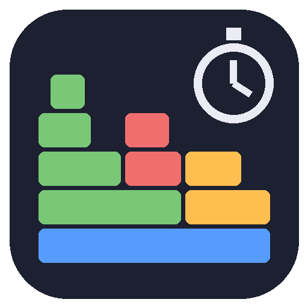
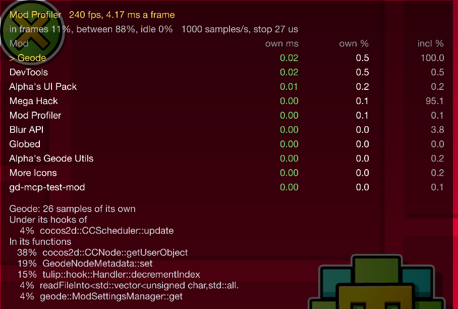

# Mod Profiler

A [Geode](https://geode-sdk.org) mod for Geometry Dash that shows how much of every frame each installed mod takes. It's a sampling profiler: about once a millisecond it stops the game's main thread for a few microseconds, reads its call stack and lets it go. Windows only.





Press `Ctrl+Shift+P` in the game for the table. Click a mod to see which of its hooks and functions its time goes to.

## What it measures

Every sample is one moment of the main thread. Over the last 5 seconds:

- **Own** (`own ms`, `own %`): the samples where the mod was doing its own work. Each sample goes to one mod at most, the innermost one on the stack that isn't just passing a call on to the original function it hooks (or to the next mod's hook of it). `own ms` is that share of an average frame: what the mod costs you a frame.
- **Inclusive** (`incl %`): the samples where the mod's code is anywhere on the stack, the game code its hooks call included. That's what goes away if the mod is removed, but a mod hooking something that wraps the whole frame is close to 100% here: Geode itself, a mod menu drawing over the game.
- **Self**: the samples where the thread was in the mod's own code right then (in the log).
- **In frames, between, idle**: *idle* is waiting in Windows (sleep, vsync, events). *Between* is the game's loop outside a frame: a frame limiter that spins on the clock instead of sleeping shows up there, not as some mod's cost.

For the mod picked in the table:

- **Under its hooks of**: the hooked functions its own time is under, like `cocos2d::CCEGLView::swapBuffers` for a mod drawing over the game
- **In its functions**: where its own time is spent, by function. Names come from the mod's PDB (a mod built on this computer has one where it was built), `Geode.pdb`, or the export table. Otherwise `module+offset`

## The log

Once a second, a line in Geode's log checks the profiler itself:

```
1005 samples in 1.01 s, suspended avg 27.4 us, max 208.2 us (stopping avg 17.7 us, max 176.7 us), 240 fps | self: Geometry Dash 0.0%, Cocos2d 6.5%, Other 71.9%, Hook handlers 0.2%, mods 21.4% | idle 0.2%, between frames 87.4% | own: geode.loader 0.8% (0.03 ms), geode.devtools 0.7% (0.03 ms), ... | inclusive: geode.loader 100.0%, absolllute.megahack 94.9%, ...
```

- **suspended**: how long the main thread stood still for one sample. **stopping** is the part spent waiting for Windows to really stop it, the rest is reading the stack
- **scanned** (when there are any): samples where the stack went through code without unwind info, and the rest of it was found by scanning
- **deep**: stacks longer than 64 frames, cut there
- **dropped**: samples the analysis had no room for

## Settings

| Setting | Default | What it does |
| --- | --- | --- |
| Show the table | `Ctrl+Shift+P` | Shows and hides the table |
| Sampling | on | Off: the profiler does nothing |
| Sample every (ms) | 1 | Less is more precise and costs more |
| Function names | on | Names from PDBs and exports, off: `module+offset` |
| Diagnostics in the log | on | The line above, once a second |
| Stacks in the log | off | A few sampled stacks as `module+offset`, for checking the profiler itself |

## Build

```sh
geode build
cmake -S tests -B build-tests && cmake --build build-tests && ctest --test-dir build-tests
```

Needs the Geode SDK (`GEODE_SDK`) and its CLI. How the parts fit together, and why some are the way they are: [docs/ARCHITECTURE.md](docs/ARCHITECTURE.md).
