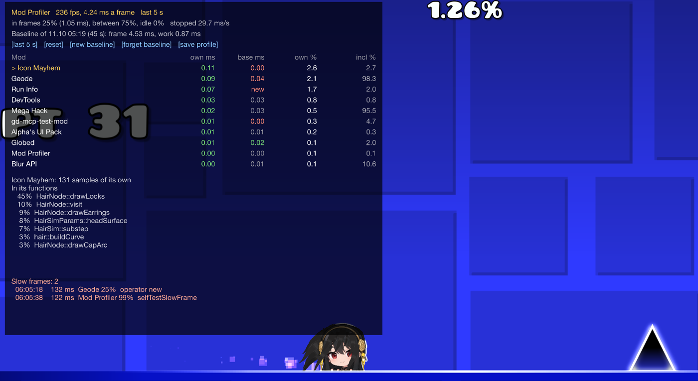

# Mod Profiler

[Русский](README.ru.md)

A [Geode](https://geode-sdk.org) mod for Geometry Dash that shows how much of every frame each installed mod takes. It's a sampling profiler: about once a millisecond it stops the game's main thread for a few microseconds, reads its call stack and lets it go. Windows only.




## Use

- `Ctrl+Shift+P` shows the table. Click a mod to see which of its hooks and functions its time goes to
- **The game's start**: the profiler loads right after Improved Logger, before the other mods, and the log says how long the game took to load and which mods' own time it was, in seconds. With 60 mods: `8.0 s ... own: ImagePlus 2.88 s (35.9%), Mega Hack 1.35 s (16.8%), Geode 0.35 s (4.3%) ...`, and where the busiest one spent it (ImagePlus decoding images under its hook of `CCImage::initWithImageFile`). The table's view button goes to **[startup]**, where **[save profile]** saves the start's flame graph
- **By scene**: **[this scene]** shows the numbers since the game went to the scene it's in (a level, the editor, a menu), and leaving a scene logs its summary
- **Slow frames** (longer than 50 ms, a setting) are listed at the bottom of the table and in the log, with the mod whose time they were, its function and a stack
- **A hang**: a frame going on for 2 seconds is told about in the log before it ends, with the mod, the function and where the thread is right now, again every 5 seconds while it lasts. A frame waiting on a lock or another thread is a possible deadlock, told about with the mod it waits in a call of. If the game freezes, the log says where
- **The session** is summed up in the log when the game closes
- `Ctrl+Shift+O` (or **[save profile]**) saves the last 10 seconds of stacks for [speedscope.app](https://www.speedscope.app): a flame graph of everything the main thread did
- **[set baseline]** keeps the session's numbers, even after a restart. The table then has a column with each mod's own time in the baseline, red when it takes more now. Before and after a mod update, with a mod turned off or on: **[reset]**, play the same thing, compare. **[last 5 s]** goes through the views: the last 5 seconds, this scene, the whole session, the game's start
- With [Improved Logger](https://github.com/ZhulinskiiDanil/improved-geode-logger): the numbers are pinned in its console, and its marker key (`Ctrl+Shift+M` in the game) logs the profile since the last marker, compared with the baseline if there is one

## Zones, for your own mod

Mark parts of your mod's code and the table shows their time under your mod, in ms a frame, with or without a PDB:

```cpp
#include "ModProfiler.hpp"   // copy include/ModProfiler.hpp, or add zhulis.mod-profiler with "required": false

void HairNode::update(float dt)
{
    mod_profiler::Zone zone("hair simulation");   // until the end of the block
    simulate(dt);
}
```

No hard dependency: without Mod Profiler a zone does nothing but check a cached pointer. Zones nest (a sample counts for the innermost), only the main thread's count, and the name must stay valid while the zone is open (a string literal is fine). The session's zones are in the log when the game closes. Checked with a zone around exactly 0.5 ms of work a frame: the table said 0.50 ms.

## What it measures

Every sample is one moment of the main thread. The table adds up the last 5 seconds (or the session):

- **Own** (`own ms`, `own %`): the samples where the mod was doing its own work. Each sample goes to one mod at most, the innermost one on the stack that isn't just passing a call on to the original function it hooks (or to the next mod's hook of it). `own ms` is that share of an average frame: what the mod costs you a frame.
- **Inclusive** (`incl %`): the samples where the mod's code is anywhere on the stack, the game code its hooks call included. That's what goes away if the mod is removed, but a mod hooking something that wraps the whole frame is close to 100% here: Geode itself, a mod menu drawing over the game.
- **Self**: the samples where the thread was in the mod's own code right then (in the log).
- **In frames, between, idle**: *idle* is waiting in Windows (sleep, vsync, events). *Between* is the game's loop outside a frame: a frame limiter that spins on the clock instead of sleeping shows up there, not as some mod's cost. *In frames* in ms is the work part of a frame.

For the mod picked in the table:

- **Under its hooks of**: the hooked functions its own time is under, like `cocos2d::CCEGLView::swapBuffers` for a mod drawing over the game
- **In its functions**: where its own time is spent, by function. Names come from the mod's PDB (a mod built on this computer has one where it was built), `Geode.pdb`, or the export table. Otherwise `module+offset`. A PDB from a build folder is read from a copy in `%TEMP%`, so the mod can be rebuilt while the game runs (the next start removes the copies)

## The log

Once a second, a line in Geode's log checks the profiler itself:

```
1005 samples in 1.01 s, suspended avg 27.4 us, max 208.2 us (stopping avg 17.7 us, max 176.7 us), cost: stopped 27.5 ms/s, sampler 1.9%, analyzer 0.3% of a core, 240 fps | self: Geometry Dash 0.0%, Cocos2d 6.5%, Other 71.9%, Hook dispatch 0.2%, mods 21.4% | idle 0.2%, between frames 87.4% | own: geode.loader 0.8% (0.03 ms), geode.devtools 0.7% (0.03 ms), ... | inclusive: geode.loader 100.0%, absolllute.megahack 94.9%, ...
```

- **suspended**: how long the main thread stood still for one sample. **stopping** is the part spent waiting for Windows to really stop it, the rest is reading the stack
- **scanned** (when there are any): samples where the stack went through code without unwind info, and the rest of it was found by scanning
- **deep**: stacks longer than 64 frames, cut there
- **dropped**: samples the analysis had no room for

A slow frame:

```
Slow frame: 121 ms, 121 samples: Mod Profiler 99% in zhulis.mod-profiler.dll!selfTestSlowFrame, the game 1%, waiting 0%
Slow frame stack: ntdll.dll!RtlQueryPerformanceCounter+0x6d < ... < zhulis.mod-profiler.dll!selfTestSlowFrame+0x52 < libcocos2d.dll!cocos2d::CCTimer::update+0xcc < ...
```

## How exact it is

Checked with known costs (`MOD_PROFILER_SELFTEST`, see Build):

- 0.500 ms of work every frame in the profiler's own code: the table said **0.514 ms a frame** on average over 30 seconds (0.49 to 0.57 a second), at 240 fps
- a 120 ms frame of its own: found, **98-99%** blamed on the right function
- a 4.5 s frame: reported as a hang after 2.7 s, 100% in the right function. A 4 s wait on an event: reported as a possible deadlock after 2.5 s

At 1000 samples a second, a share is about ±0.3% of the time for a second's numbers, less over the table's 5 seconds or a session.

## What it costs

Measured in the main menu with 60 mods installed, 80 seconds each (the log line has these numbers live):

| Sample every | Samples a second | Main thread stopped | Sampler thread | Analyzer thread |
| --- | --- | --- | --- | --- |
| 1 ms (default) | 1000 | 26 ms a second (2.6%), 26 us a sample | 1.9% of a core | 0.3% of a core |
| 2 ms | 500 | 14 ms a second (1.4%) | 0.9% of a core | 0.2% of a core |
| 5 ms | 200 | 7 ms a second (0.7%) | under 0.5% | 0.2% of a core |

The main thread standing still is the cost that matters: at 1 ms a frame takes up to about 2.6% longer. That's an upper bound: of the 26 us, about 18 are *stopping*, Windows waiting for the thread to get to a point where it can be stopped, and the thread goes on working meanwhile. Reading the stack is about 9 us. That's also why the worst single sample can say 10-20 ms: the thread was in a long system call (reading files while the game loads) and stopped only after it. The table itself shows up in the list as Mod Profiler, with about 0.1% of own time. The threads' CPU time comes from `GetThreadTimes`, which counts in 15.6 ms steps: the lowest numbers are rough. Memory: about 8 MB, most of it the last 10 seconds of stacks, and a few MB more for the game's start (about 2 MB for 8 seconds). Function names cost more while they're used: DbgHelp keeps the PDBs it read in memory (230 MB with Geode's and two mods' in a test). They're let go 30 seconds after the last name was looked up, when the table is hidden.

## Settings

| Setting | Default | What it does |
| --- | --- | --- |
| Show the table | `Ctrl+Shift+P` | Shows and hides the table |
| Table corner, Table size | top left, 1 | Where the table is and how big |
| Save a profile | `Ctrl+Shift+O` | The last 10 seconds for speedscope.app, to `profiles/` in the mod's save folder |
| Sampling | on | Off: the profiler does nothing |
| Sample every (ms) | 1 | Less is more precise and costs more |
| Slow frame (ms) | 50 | Frames longer than this are looked into |
| Slow frames in the log | on | A line and a stack for each |
| Function names | on | Names from PDBs and exports, off: `module+offset` |
| Pinned in Improved Logger | on | The numbers in its console, a profile at each marker |
| Diagnostics in the log | on | The line above, once a second |
| Stacks in the log | off | A few sampled stacks as `module+offset`, for checking the profiler itself |

## Build

```sh
geode build
cmake -S tests -B build-tests && cmake --build build-tests && ctest --test-dir build-tests
```

Needs the Geode SDK (`GEODE_SDK`) and its CLI. How the parts fit together, and why some are the way they are: [docs/ARCHITECTURE.md](docs/ARCHITECTURE.md).

`MOD_PROFILER_SELFTEST` in the game's environment checks the profiler end to end: `1` makes one 120 ms frame of its own 40 seconds in and saves a profile 5 seconds later, `play` also opens the first main level, `hang` makes a 4.5 s frame, `deadlock` waits 4 s on an event, `cost` spends 0.5 ms of every frame from 20 seconds in.
